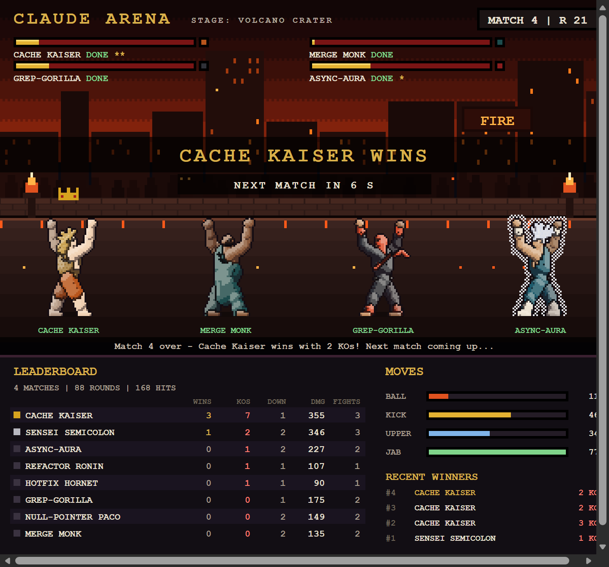
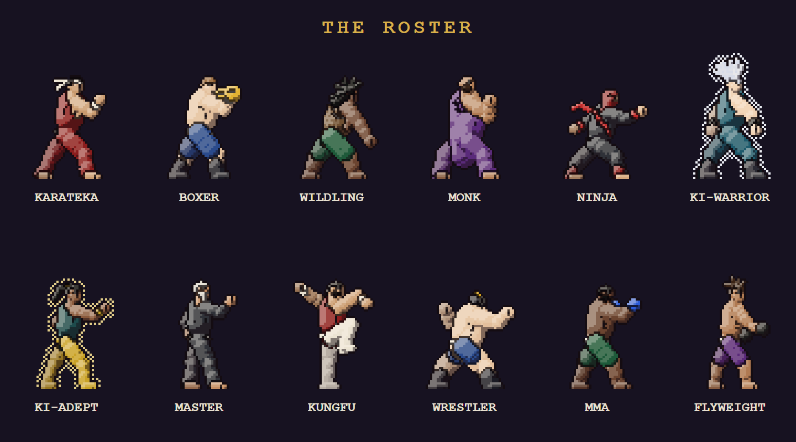

# Claude Arena

[](https://github.com/oldjazjef/claude-arena/releases/latest)
[](LICENSE)
[](https://buymeacoffee.com/hello.eme)

**Every subagent becomes a brawler.** Claude Arena is a mod for [Claude Code](https://claude.com/claude-code) that opens an arena pane beside the chat. Each subagent your session starts drops into the ring as a pixel-art martial artist, and the tools it calls turn into its moves. When every agent is done, the fighter with the most knockouts takes the crown.



## How the fight works

| What happens in the session | What happens in the arena |
| --- | --- |
| A subagent starts | A new fighter drops in: "NEW CHALLENGER" |
| The subagent runs `Bash` / `PowerShell` | Energy orb |
| `Edit` / `Write` | Kick |
| `Read` / `Grep` / `Glob` | Jab |
| `WebFetch` / `WebSearch` / MCP tools | Uppercut |
| HP drops to 0 | K.O. with dizzy stars; back on its feet after three rounds |
| The subagent finishes | Victory pose, leaves the fight (once the match has run 20 seconds) |
| All subagents finished | The fighter with the most K.O.s wins the crown; the next match starts after a short break |

Between tool calls fighters trade light blows, so the ring never stands still. A round lasts 2.1 seconds and plays up to three strikes; a match lasts at least 20 seconds.

- **Fighters:** twelve original archetypes (karateka, ninja, monk, kung-fu fighter, boxer, wildling, wrestler, MMA fighter, master, ki warrior, ki adept, flyweight), each with its own guard stance. The subagent type picks the archetype; colours vary per fighter.
- **Stages:** every match moves to the next of five stages, from a night dojo to a volcano crater, with rain, snow, embers or petals.
- **Stats:** a leaderboard under the arena counts wins, K.O.s, damage and moves across matches and sessions.





## Monster mode

The pane's second mode raises a team of pixel monsters that grow with your work. Every tool call of every session, the main one and its subagents, gives your partner XP in the background, whether the pane is open or not; it only opens when you ask for it.

| What happens in the session | What the monster gets |
| --- | --- |
| `Read` / `Grep` / `Glob` and other tools | 2 XP, a quick move |
| `Edit` / `Write` | 4 XP, a power move |
| `Bash` / `PowerShell` | 3 XP, an element move |
| `WebFetch` / `WebSearch` / MCP tools | 3 XP, a special move |
| A subagent starts | 10 XP, its strongest move |
| A turn of the main session ends | 5 XP |

- **Three lines, four stages each:** start from an egg and choose fire (Embit, Kindlur, Blazorn, Pyrathor), water (Dripple, Tidekin, Torrentusk, Abyssaur) or plant (Sproutle, Thornlet, Bramblehorn, Verdantitan). It evolves at level 8, 20 and 36 and gets bigger and wilder each time; level 50 is the top.
- **Moves:** nine per line, learned from level 1 to 45. While the pane is open the partner walks its habitat and answers each tool call with a move.
- **Gear:** every third level brings a piece of gear, from a red headband and a twig sword up to a star crown, a thunder staff and crystal wings. It is worn on the sprite, and each piece adds a little XP.
- **Team and battles:** **New egg** adds another creature (up to six) and makes it the partner, the one that earns XP. **Make partner** switches; with two hatched creatures, **Battle** starts a sparring match: turn by turn, with HP, critical hits and type matchups (fire beats plant, plant beats water, water beats fire).

The team is kept in the plugin's store across sessions, so it keeps growing day after day. All creatures, names and moves are original designs of this project.

## Install

At the prompt of a Claude Code terminal session:

```
/plugin install subagent-arena --marketplace oldjazjef/claude-arena
```

Answer `y` to add the marketplace, then pick a scope (user scope loads it in every session).

From a shell:

```bash
claude plugin install subagent-arena --marketplace oldjazjef/claude-arena
```

In the Claude desktop app, where `/plugin` does not run: click **+** next to the prompt box, then **Plugins**, **Add marketplace** with `oldjazjef/claude-arena`, then **Add plugin**. A mod installed from a terminal at the user scope loads in the desktop app's local sessions too.

To update later, at the Claude Code prompt: `/plugin marketplace update subagent-arena`, then `/plugin update subagent-arena@subagent-arena`. From a shell (PowerShell, bash) it is `claude plugin marketplace update subagent-arena`, then `claude plugin update subagent-arena@subagent-arena`. Restart the session after the update.

## Use

- `/arena` turns the arena on for this session and opens the pane. Until you run it, nothing happens: subagents do not fight and the pane stays closed. Every new session starts with the arena off.
- `/arena-demo` starts an exhibition fight with four demo brawlers, no subagents needed (it turns the arena on too).
- `/monster` opens the pane in monster mode. The **Arena** and **Monster** buttons at the top of the pane switch between the two; the pane remembers the last one.
- The pane's **Clear arena** button clears the ring; **Reset stats** wipes the leaderboard.

The animated arena and monster draw in the Claude desktop app and the VS Code extension. The terminal shows a compact text version.

## Development

The mod is a Claude Code hooks module:

| File | Role |
| --- | --- |
| `hooks/register.tsx` | Hooks: `agent.spawn`, `tool.call`, `turn.complete`, the pane and the commands |
| `hooks/sim.ts` | One round of the fight: who hits whom, damage, K.O., champion, the next match |
| `hooks/scene.ts` | Draws a round as an SVG whose SMIL animations play the strikes; the stages and their weather |
| `hooks/sprite.ts` | The pixel sprites: rigs and stances per archetype, rasterised with outline, volume shading and inner contours |
| `hooks/stats.ts`, `hooks/statsview.ts` | Running totals across matches and the leaderboard drawn under the arena |
| `hooks/mon.ts` | The monster team: XP, levels, stages, moves, gear, eggs and battles |
| `hooks/creature.ts` | The monster sprites, seen from the front: one body plan per line and stage, with gear |
| `hooks/monscene.ts`, `hooks/monhooks.tsx` | Draws the monster's beat and sparring matches; feeds it XP and keeps the team in the store |
| `types/index.d.ts` | The state contract |

Run it from a checkout with `claude --plugin-dir .` and check it with `claude plugin validate .`.

## Releases

Bump `version` in `.claude-plugin/plugin.json`, add a section to `CHANGELOG.md`, merge to `main`, then push a tag `vX.Y.Z`. The release workflow checks that the tag matches the version, packages the plugin as a zip and publishes a GitHub release with the changelog section as notes.

## License

[MIT](LICENSE). The fighters and the arena are original artwork drawn in code by this project.

## Support

Claude Arena is free. If it made your subagents more fun to watch, you can buy me a coffee.

<a href="https://buymeacoffee.com/hello.eme" target="_blank"></a>
