# Claude Arena

**Every subagent becomes a brawler.** Claude Arena is a mod for [Claude Code](https://claude.com/claude-code) that opens an arena pane beside the chat. Each subagent your session starts drops into the ring as a pixel-art martial artist, and the tools it calls turn into its moves. When every agent is done, the fighter with the most knockouts takes the crown.



## How the fight works

| What happens in the session | What happens in the arena |
| --- | --- |
| A subagent starts | A new fighter drops in: "NEW CHALLENGER" |
| The subagent runs `Bash` / `PowerShell` | Energy orb |
| `Edit` / `Write` | Kick |
| `Read` / `Grep` / `Glob` | Jab |
| `WebFetch` / `WebSearch` / MCP tools | Uppercut |
| HP drops to 0 | K.O. with dizzy stars; back on its feet after three rounds |
| The subagent finishes | Victory pose, leaves the fight (once the match has run 20 seconds) |
| All subagents finished | The fighter with the most K.O.s wins the crown; the next match starts after a short break |

Between tool calls fighters trade light blows, so the ring never stands still. A round lasts 2.1 seconds and plays up to three strikes; a match lasts at least 20 seconds.

- **Fighters:** twelve original archetypes (karateka, ninja, monk, kung-fu fighter, boxer, wildling, wrestler, MMA fighter, master, ki warrior, ki adept, flyweight), each with its own guard stance. The subagent type picks the archetype; colours vary per fighter.
- **Stages:** every match moves to the next of five stages, from a night dojo to a volcano crater, with rain, snow, embers or petals.
- **Stats:** a leaderboard under the arena counts wins, K.O.s, damage and moves across matches and sessions.

## Install

At the prompt of a Claude Code terminal session:

```
/plugin install subagent-arena --marketplace oldjazjef/claude-arena
```

Answer `y` to add the marketplace, then pick a scope (user scope loads it in every session).

From a shell:

```bash
claude plugin install subagent-arena --marketplace oldjazjef/claude-arena
```

In the Claude desktop app, where `/plugin` does not run: click **+** next to the prompt box, then **Plugins**, **Add marketplace** with `oldjazjef/claude-arena`, then **Add plugin**. A mod installed from a terminal at the user scope loads in the desktop app's local sessions too.

To update later: `/plugin marketplace update subagent-arena`.

## Use

- `/arena` opens the arena pane (it also opens by itself when the first subagent starts).
- `/arena-demo` starts an exhibition fight with four demo brawlers, no subagents needed.
- The pane's **Clear arena** button clears the ring; **Reset stats** wipes the leaderboard.

The animated arena draws in the Claude desktop app and the VS Code extension. The terminal shows a compact text version with HP bars.

## Development

The mod is a Claude Code hooks module:

| File | Role |
| --- | --- |
| `hooks/register.tsx` | Hooks: `agent.spawn`, `tool.call`, `turn.complete`, the pane and the commands |
| `hooks/sim.ts` | One round of the fight: who hits whom, damage, K.O., champion |
| `hooks/scene.ts` | Draws a round as an SVG whose SMIL animations play the strikes |
| `hooks/sprite.ts` | The pixel sprites: rigs rasterised to a grid with outline and shading |
| `types/index.d.ts` | The state contract |

Run it from a checkout with `claude --plugin-dir .` and check it with `claude plugin validate .`.

## Releases

Bump `version` in `.claude-plugin/plugin.json`, add a section to `CHANGELOG.md`, merge to `main`, then push a tag `vX.Y.Z`. The release workflow checks that the tag matches the version, packages the plugin as a zip and publishes a GitHub release with the changelog section as notes.

## License

[MIT](LICENSE). The fighters and the arena are original artwork drawn in code by this project.
